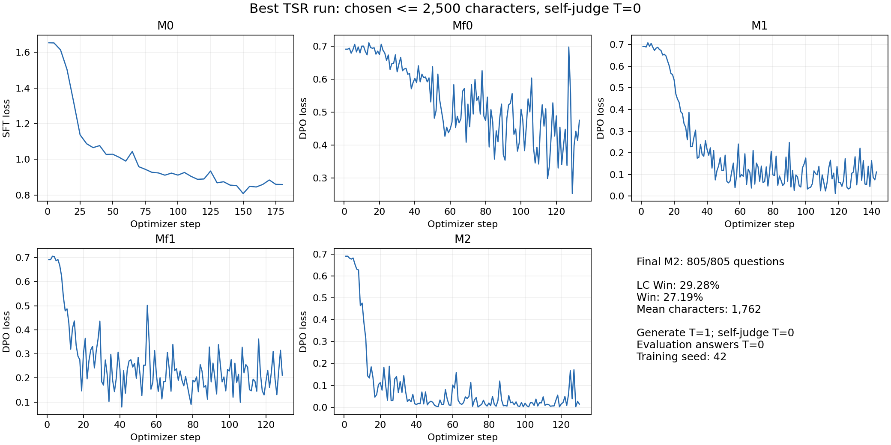

# Best completed TSR experiment

**Run:** `tsr-llama31-8b-cap2500-judge0-1113a` · **Final model:** `M2_future_tie_charcap_distinct`

| Evaluation | Questions | LC Win (%) | Win (%) | Mean characters | Truncated |
|---|---:|---:|---:|---:|---:|
| AlpacaEval 2.0 | 805 / 805 | **29.2798** | **27.1869** | **1,761.7553** | 2 / 805 |

The highest completed LC Win is the selection criterion. This is one fresh seed-42 run, evaluated at answer-generation temperature 0. Local self-judge temperature is 0, training generation temperature 1, external GPT-4o judge temperature 1. See [the exact rules and configuration](../../docs/BEST_RUN.md).



These are native training losses. Only final M2 was evaluated; this run has no per-step AlpacaEval curve. Loss values are not evaluation win rates or self-judge reward.

## Files

- `runs/tsr-llama31-8b-cap2500-judge0-1113a/evaluation/M2_future_tie_charcap_distinct/`: all 805 generated answers (`model_outputs.json.gz`), all 805 GPT-4o annotations (`annotations.json.gz`), exact leaderboard, generation diagnostics and scoring completion marker.
- `inputs/alpaca_reference.json`: exact frozen 805-question reference.
- `metrics/results.csv` and `results.json`: this run's final metrics only; `pair-filtering.csv`: the four canonical preference-dataset summaries.
- Run `training/` and `training_metrics/`: five stages' scalar histories, inference timings/sampling settings, cache-cleanup manifests and self-judge-temperature validation.
- Run `pair_statistics/`: pair counts, score/source/text/character-cap filtering evidence and hashes of canonical training data. Training pair texts are not included in this Git archive.
- Run `configs/`, `provenance/`, `lifecycle.json`: actual stage configs, input/model manifests, job details, source hashes and completion markers. Provider URLs and credential fields were removed from exported metadata.
- Run `source_snapshot/`: immutable source used by the executed experiment. Historical defaults in this snapshot are overridden by the frozen run plan and actual configs.
- `manifest.json`: file sizes and SHA-256 hashes for every other file in this archive.

Raw training candidates/judgments, API request caches, model weights, optimizer state and secrets are excluded. Other new experiments are not added in this branch. Existing repository historical results are retained.

## Verify without GPU or API calls

```bash
python3 scripts/verify_best_run.py
```

The verifier checks the manifest, scored-input/reference hashes, all 805 annotation-to-answer/reference matches, leaderboard metrics, recorded sampling temperatures and four dataset filtering summaries. It verifies archived evidence, not unavailable candidate texts or a new training run. The exact native `win_rate` is retained; `discrete_win_rate` is a separate leaderboard field.

The runnable code was imported from source commit `48c67ce491ad894634bf538601e70649f6c3a893`; the frozen executed source remains separately available. Training was not re-run during publication.
